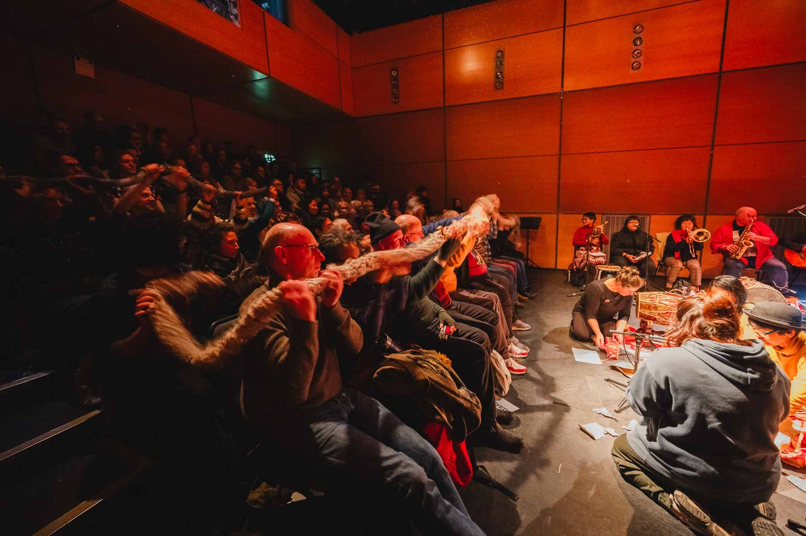
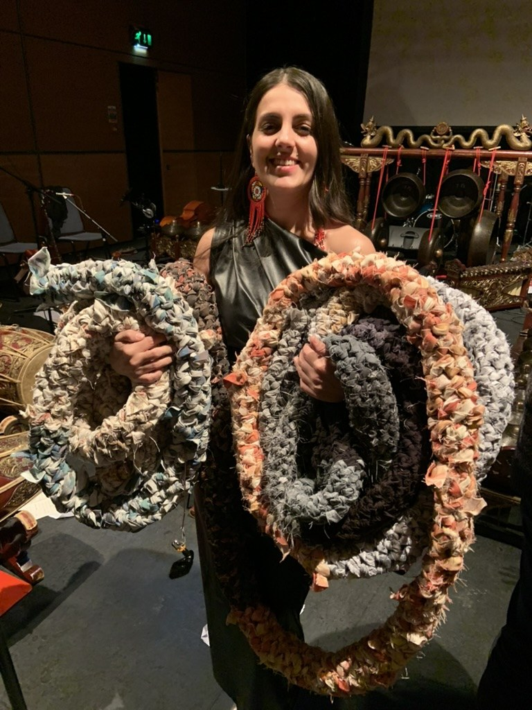

# Dreams Made on Charity Shop Sheets

*A collaborative soft instrument for many bodies.*


*In performance: the audience plays the tube from their seats. Photo: Brian Hartley, Still Motion Art.*

*Dreams Made on Charity Shop Sheets* (Maria Sappho, 2025) is an experimental electronic textile instrument that transforms handmade crocheted fabric into an interactive interface for sound and improvisation.

It is a crocheted tube about 30 metres long, made from bed sheets bought in charity shops. A **piezoelectric cable** runs through the whole length of the tube. When the audience picks it up and shakes it together, the cable senses the movement and triggers a library of percussion sounds played back through a Teensy microcontroller. Calm, single movements bring long, resonant gongs and bells. Busy shaking brings short strikes. When everyone stops, one last long sound rings out.



The piece was inspired by gamelan: one instrument that needs many bodies to play it. The aim was to make possibly the longest collaborative soft instrument, one that a whole audience can hold at once.

The tube is a general-purpose controller. The percussion library is just one way to use it. You can load your own sounds or rewrite the firmware for any kind of interaction.

**Premiere:** November 2025, Centre for Contemporary Arts (CCA), Glasgow, at GIOfest XVII, played by the festival audience as part of *Tonna Miann*, a collaborative work by Nadya Hatta, Debbie Armour, Arum Dayu and Maria Sappho. See the [score notes](score/README.md#premiere).

---

## What's in this repository

| Folder | Contents |
|---|---|
| [`score/`](score/) | The score: performance instructions and setup |
| [`build/`](build/) | How to build the instrument: parts, the crochet tube, the piezo cable and the electronics |
| [`hardware/enclosure/`](hardware/enclosure/) | 3D-print file for the electronics box |
| [`firmware/`](firmware/) | Teensy code for the performance |
| [`tools/piezo_test/`](tools/piezo_test/) | A minimal sketch for testing and calibrating the piezo cable |
| [`sounds/`](sounds/) | Information about the percussion sound library and where to download it |

## Where to start

1. Read the **[one-page score (PDF)](score/score.pdf)**, then the [full score notes](score/README.md).
2. Collect the parts in the [parts list](build/01-parts-list.md).
3. Make the [crochet tube](build/02-crochet-tube.md).
4. Learn how the [piezo cable](build/03-piezo-cable.md) works and wire it up.
5. Print the [box](hardware/enclosure/), set up the [Teensy, SD card and firmware](build/04-electronics-and-firmware.md), then calibrate.

Or skip the electronics entirely: the [installation version](build/05-installation-version.md) hangs the tube from the ceiling and simply amplifies it through a guitar amp.

## How it works

```
 audience shakes the tube
          │
          ▼
 piezo cable inside the tube  ──►  wireless guitar transmitter
                                             ┊ radio
                                             ▼
                        electronics box:  wireless receiver ──► Teensy 4.1
                                                                    │
                                                   picks a sound from the SD card
                                                                    │
                                                                    ▼
                                              Teensy Audio Shield ──► speakers / PA
```


## Credits

- **Concept, instrument design, crochet, electronics and code:** Maria Sappho
- **Percussion sounds performed by:** Colin Frank

## Licence

- **Sounds, score, documentation, photos and enclosure:** [CC BY-NC 4.0](https://creativecommons.org/licenses/by-nc/4.0/). Free to perform, build and adapt for non-commercial use, crediting Maria Sappho and Colin Frank.
- **Code:** MIT.

See [LICENSE.md](LICENSE.md).
