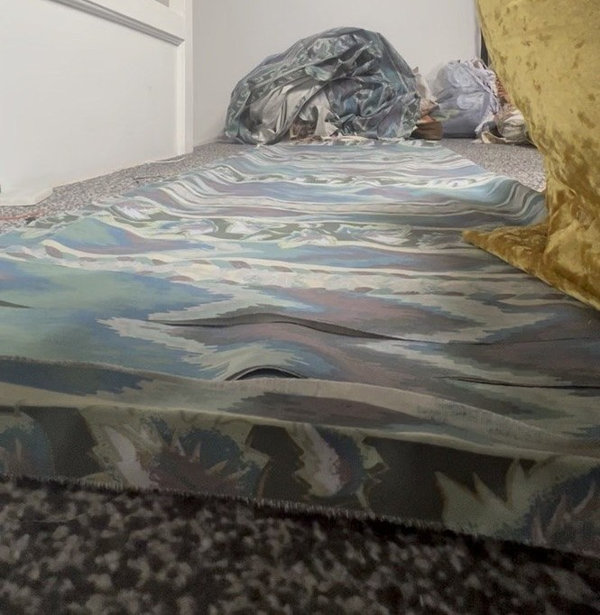
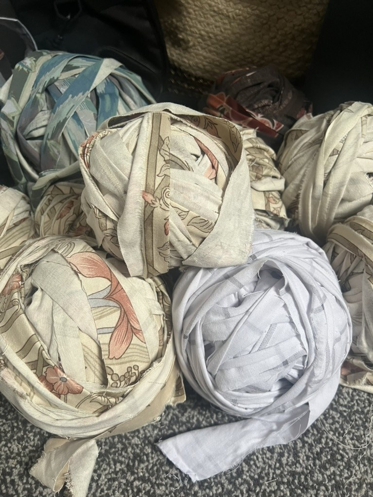

# Making the crochet tube

The tube is about **30 metres** long, crocheted from strips of second-hand bed sheets, with the piezo cable running through the middle. It is soft enough to be held, passed around and shaken by a whole audience, and coils up for transport.

There is no fixed pattern. The exact sheets, hook and stitch count don't matter. What matters is a tube that is **long, soft, sturdy enough to be pulled on, and holds the cable**.

## 1. Collect sheets

- Use bed sheets from charity shops. The original used many sheets of different colours and patterns, joined as they ran out, which gives the tube its striped look.
- Wash them first.
- How many you need depends on the sheets and on how thick you make the tube. Just keep collecting until you reach the length you want.

## 2. Cut the sheets into yarn

Turn each sheet into one long strip of fabric "yarn".

1. Cut off the hems.
2. Cut the sheet into strips a few centimetres wide (the strips in the photos are roughly 3–5 cm). Thinner sheets can be cut wider.
3. To get one continuous strip without joins, cut back and forth: cut along the sheet, stop about 2 cm before the edge, turn and cut back the other way, like a zigzag.
4. Or cut separate strips and join them: cut a small slit near the end of each strip, pass one strip through the other's slit, and pull tight. This makes a knot-free join.
5. Wind the strips into balls.

Raw edges are fine. Fraying is part of the look.

## 3. Crochet the tube

- **Hook:** use a **very large** hook. Choose whatever suits the thickness of your sheets: thicker or wider strips need a bigger hook. Rag crochet hooks of 10–25 mm are common.
- **Stitch:** any simple stitch worked round and round in a **continuous spiral** makes a seamless tube. Single crochet (UK double crochet) gives a dense, sturdy fabric.
- **Width:** make the tube wide enough for the cable to sit inside comfortably and thick enough to be grabbed with both hands.

1. Chain a few stitches and join them into a ring.
2. Crochet round and round in a spiral, without joining each round.
3. Keep the tension firm and even so the tube holds its shape and grips the cable.

## 4. Put the piezo cable inside

There are two ways to do this:

- **Crochet around the cable as you go.** Lay the end of the cable inside the ring and keep crocheting around it, feeding the cable through as the tube grows. This avoids threading 30 m of cable through afterwards.
- **Thread it through afterwards.** Tie the cable to a long stiff rod or a weighted cord and pull it through in sections. This only works if the tube is loose enough.

Either way:

- Leave enough cable sticking out of one end to fit the jack plug and wireless transmitter (see [piezo cable](03-piezo-cable.md)).
- **Anchor the cable** at both ends with a few stitches or cable ties through the crochet, so the audience pulling on the tube doesn't pull the cable out or strain the connector.
- The cable should be snug but not tightly bound. It needs to move with the tube to pick up shaking.

## 5. Finishing

- Close the far end of the tube by crocheting the last round closed, or gathering it with a strip.
- At the cable end, close the tube around the cable and fix it in place.
- Coil the tube loosely for storage. Don't fold the cable sharply, as kinks can damage the piezo layer.

## Care and transport

- Coil, don't fold.
- The tube can't be machine washed with the cable inside. Spot clean, or air it out.
- Check the cable with the [piezo test sketch](../tools/piezo_test/piezo_test.ino) after transport and before each performance.
