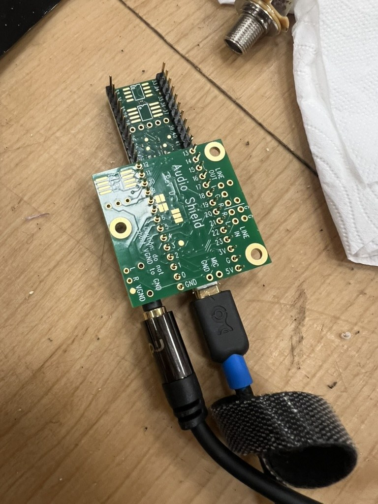
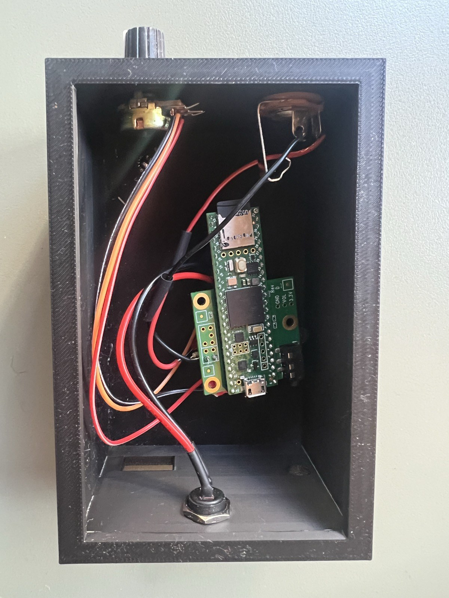
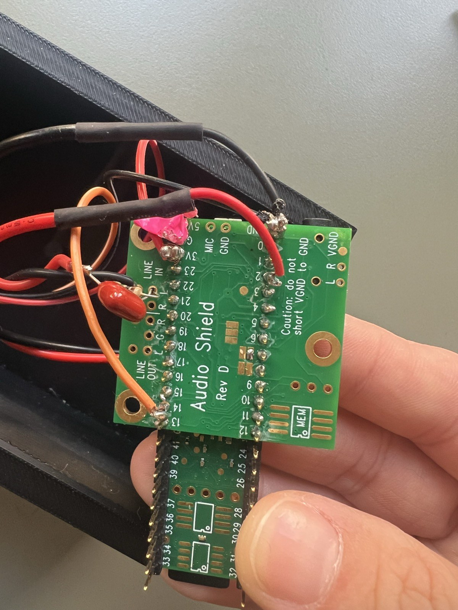

# Electronics and firmware

## The boards

- **Teensy Audio Shield, Rev D:** listens to the signal from the wireless receiver on its **LINE IN** and plays the sounds.
- **Teensy 4.1:** detects movement in that signal and decides which sound to play.

Get the Audio Shield **Rev D** (made for Teensy 4.x), not Rev C (for Teensy 3.x).

The Audio Shield stacks on top of the Teensy using header pins, as in the photo. Solder long-legged female headers or stacking headers so the two boards plug together and can be separated for repair.

### Which pins are used

| Pin | Used by |
|---|---|
| 7, 8, 20, 21, 23 | Audio Shield (I2S audio) |
| 18, 19 | Audio Shield (I2C control) |
| **LINE IN (L)** on the Audio Shield | **Input from the wireless receiver** |
| **14 / A0** | **Volume knob** (10 kΩ linear potentiometer, middle leg) |
| 3.3V, GND | Outer legs of the volume knob |

The sounds are read from the **SD card slot on the Teensy 4.1 itself** (`BUILTIN_SDCARD`), not the SD slot on the Audio Shield. The built-in slot is faster.

### Audio output

The Audio Shield's 3.5 mm jack is a headphone output. For performance, run it into a PA, mixer or powered speakers with a 3.5 mm to 2×jack or 3.5 mm to 2×XLR cable (via DI box if needed). The `LINE OUT` pads on the shield give a cleaner signal for a mixer, if you solder a socket to them.

## The box

Everything lives in a 3D-printed box. The print file is in [`hardware/enclosure/`](../hardware/enclosure/).

Inside:

- **Teensy 4.1 + Audio Shield** in the middle.
- **¼" jack socket** (top right in the photo): the input from the wireless guitar receiver, wired to **LINE IN** on the Audio Shield (tip → LINE IN L, sleeve → GND).
- **Volume knob** (top left): a 10 kΩ linear (B10k) potentiometer, outer legs on 3.3 V and GND, middle leg on **A0**.
- **Audio out socket** on the opposite end (bottom of the photo), wired from the Audio Shield's output to the PA or speakers.
- **Power switch** on the front.
- **USB power bank** inside the box, connected to the Teensy with a USB cable, so the box is completely self-contained with no mains cable.

## Power

A USB power bank inside the box powers the Teensy. A power bank avoids ground hum from mains power and lets the box sit anywhere on stage. Charge both the power bank and the wireless transmitter before each performance.

## Software setup

1. Install the [Arduino IDE](https://www.arduino.cc/en/software).
2. Install Teensy support. In Arduino IDE 2, add this URL under **Preferences → Additional boards manager URLs**:
   `https://www.pjrc.com/teensy/package_teensy_index.json`
   then install **Teensy** from the Boards Manager. The Audio and SD libraries come with it.
3. Select **Tools → Board → Teensy 4.1**.
4. Open [`firmware/charity_shop_sheets/charity_shop_sheets.ino`](../firmware/charity_shop_sheets/charity_shop_sheets.ino), then upload. The first upload may ask you to press the button on the Teensy.

## Preparing the SD card

1. Use a microSD card formatted as **FAT32** (or exFAT for cards over 32 GB). The [SD Association formatter](https://www.sdcard.org/downloads/formatter/) is the most reliable.
2. Make two folders in the root of the card, **`LONG`** and **`SHORT`**, and copy the long and short sounds into them (see [sounds](../sounds/README.md)). The code loads up to 32 files from each folder.
3. Files must be **16-bit, 44.1 kHz WAV**. Other formats won't play.
4. Keep filenames simple: lowercase letters, numbers, `_` and `-`. Avoid spaces and `#`.

## Calibrating

Calibrate in the performance space, with the tube laid out as it will be used, because the length and layout affect the signal.

1. Connect the Teensy to a computer by USB and open the Serial Monitor at **9600 baud**.
2. Check the startup message lists the files in `/LONG` and `/SHORT`.
3. Shake the tube gently. Each hit prints its `level`. If gentle shakes don't trigger, lower `HIT_THRESHOLD` (try 0.004–0.008) or raise `sgtl5000_1.lineInLevel()`.
4. Shake hard and for a while, and watch `motionEnergy` rise. Adjust `HIGH_ENERGY` to change when it switches from long to short sounds.

All the settings are explained in the [firmware README](../firmware/README.md#settings-to-adjust).
