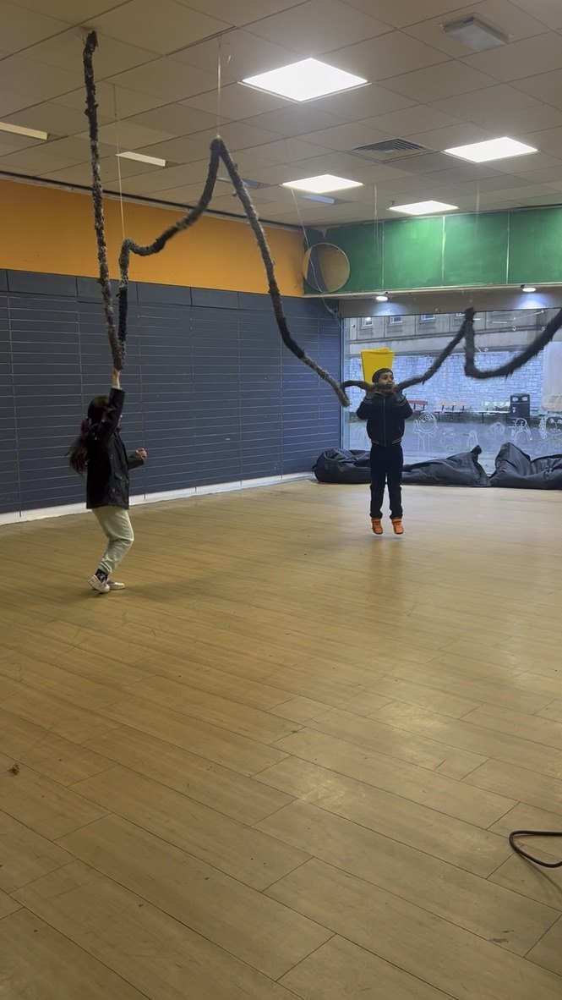
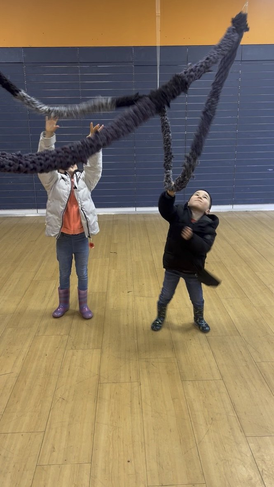
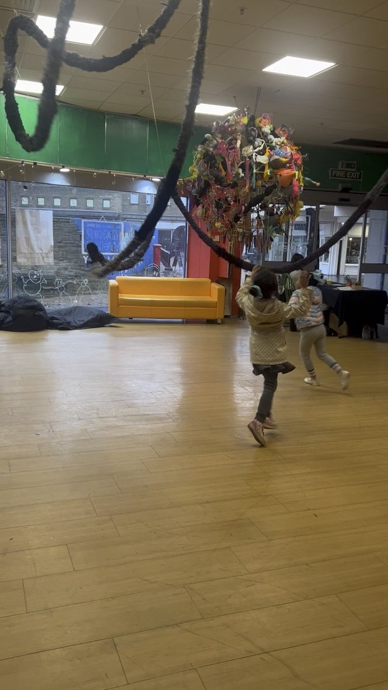

# Installation version: simply amplified

The tube doesn't need the Teensy, the code or the sound library. In its simplest form, it can be installed as an **amplified piezo**: the sound of the tube itself being touched, shaken, rubbed and swung, made loud through speakers. There are no effects and no samples.

This version suits open, drop-in settings such as community spaces, workshops and family events, where people (including children) can wander in and play for as long as they like.



| | |
|---|---|
|  |  |

*Photos used with the permission of the children's parents.*

## Hanging the tube

In the installation version the tube is **suspended from the ceiling** at several points, so it loops through the space in big curves. Some sections hang low enough to reach and grab, and others sweep up high.

- Hang it from **thin, clear line** (for example fishing line) at several points along its length, so it looks like it's floating.
- Leave **low loops and loose ends** at heights children and adults can both reach.
- Hang it from ceiling grid clips, hooks or a rigging point that can take a person pulling on it, not just the tube's own weight. People will grab and swing on it.
- Check with the venue about what the ceiling can hold.

## Signal chain

```
 piezo cable inside the tube
          │
   ¼" jack plug  (or the wireless guitar transmitter and receiver)
          │
 high-impedance instrument input  (guitar amp, mixer "Hi-Z"/instrument input, or DI box)
          │
 speakers
```

The Teensy box isn't used. Plug the tube (or the wireless receiver) straight into:

- **a guitar or bass amp.** This is the simplest option: one box, already designed for this kind of signal.
- **a mixer or audio interface with a "Hi-Z" or "Instrument" input**, then out to speakers.
- **a DI box** into a normal mixer input, if the mixer has no Hi-Z input.

### Why the input type matters

A piezo, like a guitar pickup, gives a very small signal and needs a **high-impedance input** (around 1 MΩ). Plugged into a normal line or microphone input, it sounds thin and quiet, with most of the low end missing. Guitar amps, Hi-Z inputs and DI boxes all provide that high impedance.

## What it sounds like

You hear the tube's own sounds: rustling fabric, knocks, scrapes, creaks in the line, and the thuds of people grabbing it. EQ can tame harsh highs, and a little reverb helps in a dry room, but the idea is to amplify the instrument as it is.

## Safety

- **Feedback:** a piezo is much less prone to feedback than a microphone, but keep speakers pointing away from the hanging points and start with the volume low.
- **Volume for children:** keep levels moderate. Sudden yanks can be loud.
- **Cables:** run speaker and power cables away from where people walk and play, or tape them down. The wireless system helps here, because there's no cable from the tube.
- **Strangulation risk:** loops of hanging rope near children need supervision. Keep low loops large and open, and don't leave the installation unattended.
