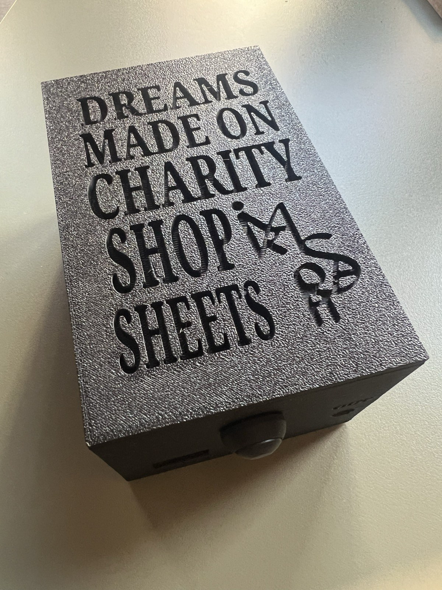

# Enclosure

[`charity-shop-sheets-enclosure.stl`](charity-shop-sheets-enclosure.stl) is the 3D-print file for the electronics box. GitHub shows an interactive 3D preview if you click on it.

The file contains both parts laid out on one build plate:

- **Box:** about 83 × 129 × 65 mm, with holes for the input jack, the knob and the panel socket.
- **Lid:** about 83 × 129 × 8 mm, engraved with the title, *Dreams Made on Charity Shop Sheets*.

## Printing

Print in **PLA**. Supports are needed for some overhangs. The original was printed in black with a textured surface.

## Fitting the parts

The lid is a snug friction fit, so it needs no screws or glue.

## Changing the design

If you only have the STL, it can be edited in most 3D tools (Tinkercad, Fusion, Blender). If you have the original design file, add it here too so others can change the hole sizes for their own jacks and knobs.
