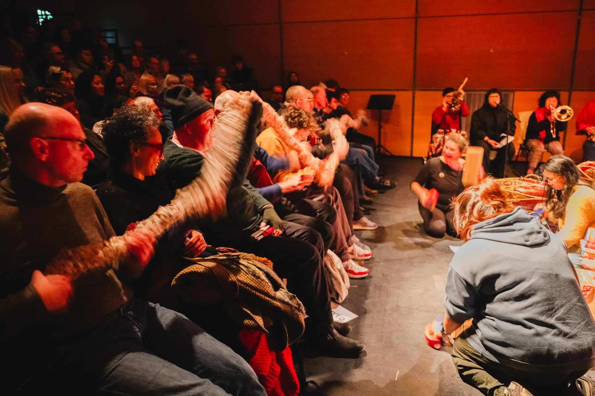

# Dreams Made on Charity Shop Sheets: score

*for many bodies and one 30-metre soft instrument*
Maria Sappho, 2025 · percussion sounds performed by Colin Frank

**The one-page score is [`score.pdf`](score.pdf).** It's made from [`score.html`](score.html): edit the HTML, then print it to PDF from a browser (A4, no margins, background graphics on).

## About the piece

*Dreams Made on Charity Shop Sheets* is an experimental electronic textile instrument that transforms handmade crocheted fabric into an interactive interface for sound and improvisation.

Like a gamelan, it is one instrument that needs many bodies to play it. A 30 m tube crocheted from charity shop bed sheets carries a piezoelectric cable along its whole length. Touching, pulling, scrunching, striking, stretching and shaking the textile become ways of exploring sound, triggering percussion sounds performed by Colin Frank.

The project brings together experimental instrument design, textile craft, electronic sound and improvisation. It is intended to be reproducible and adaptable, encouraging artists, musicians and makers to develop their own versions using accessible electronic components and handmade or repurposed materials.

## Instructions

1. Lay the tube along the audience: across laps, along the rows, looped through the space.
2. It cannot be played alone. Invite everyone to pick up a piece of it.
3. Move together. Lift it, shake it, ripple it, pass a wave from one end to the other.
4. Listen through the tube. A single jolt rings out long. Many hands shaking scatter into short strikes.
5. When everyone becomes still, one last sound rings. Let it fade completely.
6. Begin again, or let go. The piece ends when the last person puts it down.

## Performers

- **The audience.** Any number of people, as long as it's more than one.
- **Instructions before the piece.** Explain to the audience what to do before the performance starts.
- **A plant in the audience (optional).** At the premiere, someone in the audience started the tube moving, which gave everyone else permission to join in.

*Photo: Brian Hartley, Still Motion Art.*

## Duration, beginning and ending

There is no fixed duration, and no fixed way to begin or end. These are up to the performers and the situation.

## Setup

- In performance, the tube runs **along the audience**: across laps and along the front rows, so people play it from their seats.
- The Teensy box sits at one end, and its output (a 3.5 mm mini jack) goes into a mixer or PA. Use an adapter if your mixer doesn't take a mini jack. Running it through a mixer also makes it easy to combine with other electronics and instruments.
- Calibrate the sensitivity in the space before the audience arrives (see [calibrating](../build/04-electronics-and-firmware.md#calibrating)).

## Versions

The piece can be presented in two ways:

1. **Performance version.** The tube's movement triggers Colin Frank's percussion sounds through the Teensy box. Calm movement brings long, ringing sounds, busy shaking brings short strikes, and stillness brings one final ringing sound. See [electronics and firmware](../build/04-electronics-and-firmware.md).
2. **Installation version.** The tube hangs from the ceiling in loops, and its own sound is simply amplified, with no code or samples. People drop in and play for as long as they like. See [installation version](../build/05-installation-version.md).

## Making your own version

The tube can be used for any kind of interaction, not just the recorded percussion. You are welcome to make your own version, with your own textiles, your own sounds or your own code.

Large soft textiles, collaborative performance and piezo electronics are not Maria Sappho's inventions: they belong to everyone. What she asks is:

- **Credit Maria Sappho for the design concept:** *Dreams Made on Charity Shop Sheets* by Maria Sappho.
- **If you use Colin Frank's recordings, credit both:** percussion sounds performed by Colin Frank, recorded by Maria Sappho.

## Premiere

November 2025, Centre for Contemporary Arts (CCA), Glasgow, at GIOfest XVII. Played by the festival audience.

The piece was Maria Sappho's contribution to *Tonna Miann*, a larger collaborative work by Nadya Hatta, Debbie Armour, Arum Dayu and Maria Sappho, performed with members of Glasgow Improvisers Orchestra, Perempuan Komponis and Gamelan Naga Mas. This was part of *Gamelan Voices: Scottish-Indonesian improvisations*, supported by the British Council's Connections Through Culture programme.

The score is also published in *Dòchas Harapan* (VIR Press, in association with Glasgow Improvisers Orchestra).
